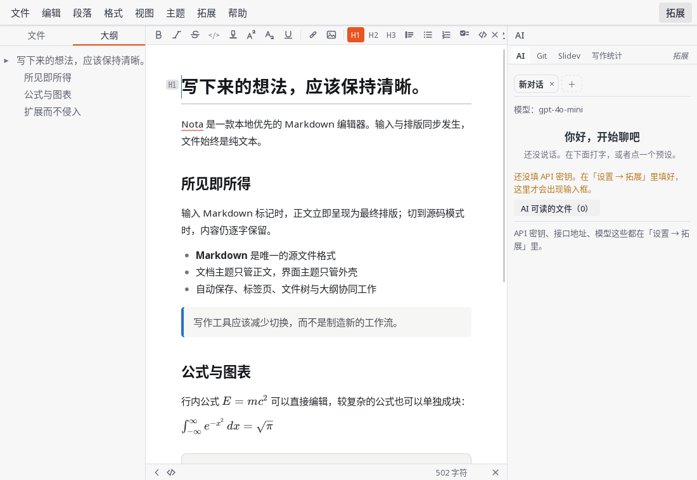
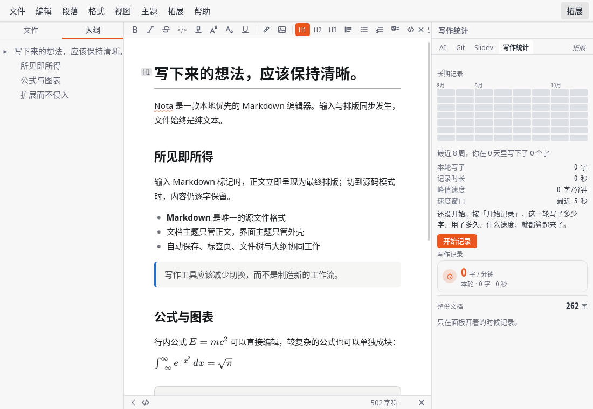

<p align="center">
  
</p>

<h1 align="center">Nota Plugins</h1>

<p align="center">Official Lua extensions for Nota.</p>

<p align="center">
  <a href="README.zh-CN.md">简体中文</a> ·
  <a href="https://github.com/Nota-MD/Nota/releases">Nota releases</a> ·
  <a href="https://nota-md.github.io/docs/">Documentation</a>
</p>

Official extensions are installed separately from Nota. Each extension receives only the
capabilities declared in its `plugin.toml`.

<table>
  <tr>
    <td width="50%"></td>
    <td width="50%"></td>
  </tr>
  <tr>
    <td align="center">AI assistant</td>
    <td align="center">Writing statistics</td>
  </tr>
</table>

## Extensions

| Extension | id | Version | Purpose |
|---|---|---:|---|
| AI assistant | `nota.ai` | 0.1.0 | Rewrite, continue, summarize and translate with your own API configuration |
| Git | `nota.git` | 0.1.0 | Status, diffs, history and commits using system Git |
| Slidev | `nota.slidev` | 0.1.0 | Preview the current Markdown document as slides |
| Writing statistics | `nota.stats` | 0.5.0 | Track a writing session, long-term activity and share cards |

## Install

1. Download a `.nota-plugin` package from [Releases](https://github.com/Nota-MD/Nota-plugins/releases).
2. Open **Settings → Extensions → Install from file…** in Nota.
3. Restart Nota after installation.

Development builds discover this repository automatically when `Nota` and `Nota-plugins`
are checked out side by side. Set `NOTA_PLUGINS_DIR` to override that location.

## Repository layout

- `plugins/<id>/plugin.toml` — manifest, capabilities, settings and entry file
- `plugins/<id>/main.lua` — extension entry point
- `plugins/<id>/lang/` — translations keyed by English source strings
- `tools/pack-plugin.py` — package a directory as `.nota-plugin`, with optional signing
- `tools/check.sh` — repository checks and headless extension tests
- `compatibility.json` — host API and extension version contract

## Development

```sh
bash tools/check.sh
python3 tools/pack-plugin.py plugins/git
```

The packaging tool requires OpenSSL for signing. Never commit a signing private key.

## Capabilities

Nota does not expose a general-purpose filesystem or network API. An extension only receives
the API tables allowed by its manifest. For example:

```toml
capabilities = [
  "document.read",
  "ui.panel",
  "ui.notify",
]
```

Without `network.http`, `nota.http` does not exist. Without `document.write`, the extension
cannot modify the current document.

## Updates and release metadata

Packages and release notes are published under
[Releases](https://github.com/Nota-MD/Nota-plugins/releases).

Machine-readable release metadata is published in [`latest.json`](latest.json). Consumers
should ignore unknown fields.

## Contributing

AI-assisted contributions are welcome. The submitter must understand the change, verify asset
licenses and personally run the extension in Nota. See the full
[extension tutorial](https://nota-md.github.io/docs/#/developer/extensions/README).

## License

BSD-2-Clause. See [`../Nota/LICENSE`](https://github.com/Nota-MD/Nota/blob/main/LICENSE).
